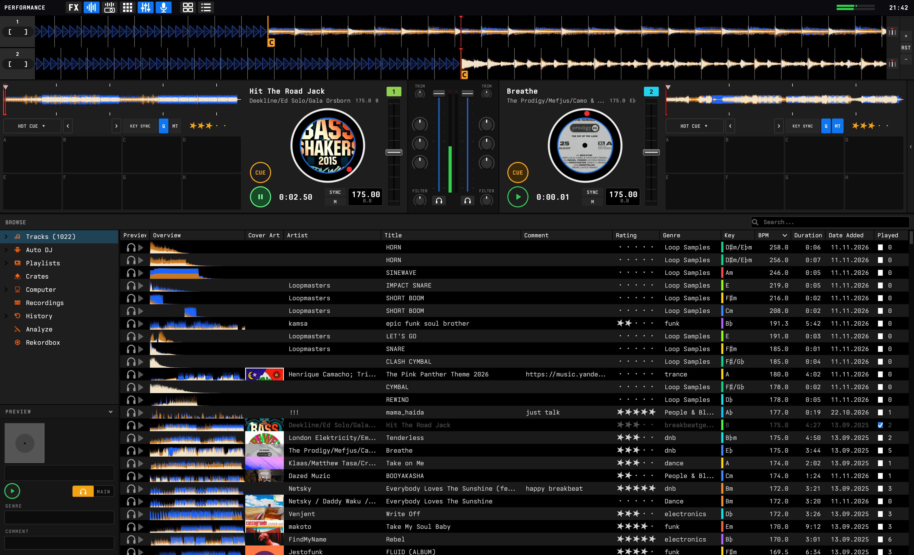
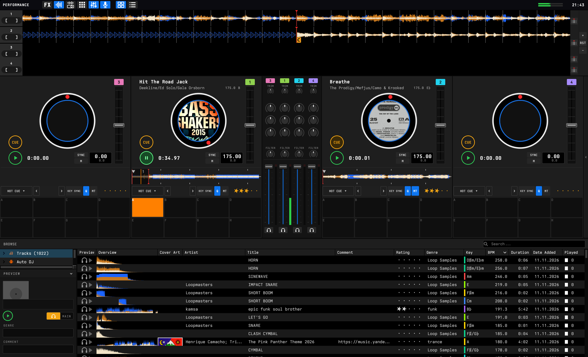

# kamsa (stock)

A [Mixxx](https://mixxx.org) skin with a performance layout: big vinyl platters with cover art, stacked waveforms, a center mixer and a browser with a preview deck. It is a fork of Rekordmixxx.

This is the **stock** variant. It uses only widgets and options that upstream Mixxx already ships, so it runs on an unmodified build. It was tested on Mixxx `main` (2.7-alpha).





## Features

- Global bar with toggles for FX, waveforms, samplers, mixer, microphones, the 4-deck layout and the maximized library
- Stacked scrolling waveforms for decks 1–4
- Player decks:
  - track title, plus a line with artist, BPM and key (long names are elided)
  - platter with cover art and a rotating marker
  - CUE and PLAY buttons
  - elapsed/remaining time (click to cycle)
  - SYNC and leader (M) buttons
  - BPM and pitch box
  - slim tempo fader
  - overview waveform
  - 8 hotcue pads with key sync, quantize and key lock
- Center mixer for 2 or 4 channels: trim, EQ, filter, faders with VU meters, and headphone cue
- Sampler deck, effects panel, and a library side panel with a preview deck and genre/comment fields
- Dark and Amber color schemes

## Install

Clone or copy this folder into your Mixxx user skins directory:

| OS | Skins directory |
| --- | --- |
| macOS (App Store or sandboxed build) | `~/Library/Containers/org.mixxx.mixxx/Data/Library/Application Support/Mixxx/skins/` |
| macOS (other builds) | `~/Library/Application Support/Mixxx/skins/` |
| Linux | `~/.mixxx/skins/` |
| Windows | `%LOCALAPPDATA%\Mixxx\skins\` |

```sh
git clone https://github.com/v1vendi/kamsa_mixxx_skin_stock.git "<skins directory>/kamsa_stock"
```

Restart Mixxx. Then choose **kamsa (stock)** under Preferences → Interface → Skin.

## Differences from the full kamsa skin

The full skin needs custom C++ widget options that upstream Mixxx doesn't have. This variant leaves them out:

- **Platter:** no readout drawn on the platter, no beat-jog ring, no strobe and no tempo ring. Title, time, BPM and transport sit around the platter instead, because the Spinny is a native GL window and nothing can be drawn over it.
- **Waveforms:** stock waveform and beat-grid rendering.
- **Hotcue pads:** each pad shows its plain letter instead of a styled chip.
- **Library:** genre and comment use the stock click, pause, click editing.

## License

CC BY-SA 4.0. Based on Rekordmixxx by its contributors. All artwork is original vector art made for this skin.

"rekordbox" is a trademark of AlphaTheta Corporation. This skin is not affiliated with AlphaTheta.
